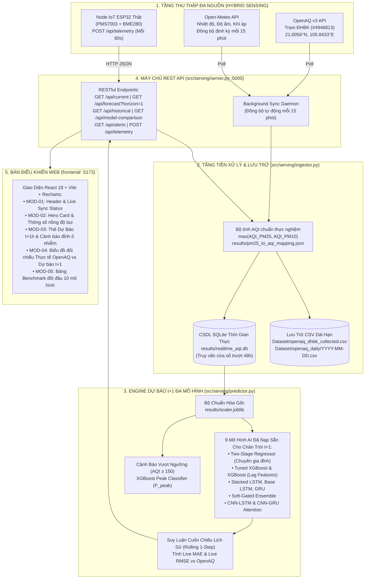

# BÁO CÁO TỔNG HỢP CÁC NỘI DUNG MỚI TRIỂN KHAI
## HỆ THỐNG QUAN TRẮC VÀ DỰ BÁO CHỈ SỐ AQI THỜI GIAN THỰC (CHÂN TRỜI t+1)
### ỨNG DỤNG MÔ HÌNH HỌC MÁY, HỌC SÂU VÀ THIẾT BỊ IOT NGOẠI VI

- **Sinh viên thực hiện:** Trần Trung Hiếu
- **Mã số sinh viên:** 20235934
- **Mục tiêu trọng tâm báo cáo:** Tổng hợp toàn bộ các kết quả phát triển mới nhằm chuyển đổi hệ thống từ mô hình nghiên cứu offline sang **vận hành trực tuyến thời gian thực (End-to-End Real-Time Serving)**, tập trung chuyên sâu vào **chân trời dự báo ngắn hạn $t+1$ (dự báo trước 1 giờ)**.
- **Thời gian báo cáo:** Ngày 05 tháng 11 năm 2026

---

## 1. TỔNG QUAN ĐỊNH HƯỚNG MỚI: TẬP TRUNG CHÂN TRỜI DỰ BÁO t+1

Trong giai đoạn này, toàn bộ hệ thống được tái cấu trúc và tối ưu hóa để tập trung vào mục tiêu: **Dự báo chỉ số chất lượng không khí (AQI) chính xác tại thời điểm 1 giờ tiếp theo ($t+1$)**.

### 1.1. Ý nghĩa thực tiễn của chân trời dự báo $t+1$
- **Cảnh báo tức thời (Real-Time Early Warning):** Khoảng thời gian 1 giờ là khoảng thời gian vàng để người dân, trường học và các tòa nhà văn phòng kích hoạt các biện pháp phòng hộ (đóng cửa sổ, bật máy lọc không khí công suất cao, hạn chế tập thể dục ngoài trời).
- **Độ tin cậy và phản ứng nhanh:** So với các dự báo dài hạn vốn phụ thuộc nhiều vào diễn biến thời tiết vĩ mô, dự báo $t+1$ bám sát trực tiếp vào quán tính lan truyền bụi và vi khí hậu cục bộ, giảm thiểu sai số tích lũy.
- **Phục vụ điều khiển tự động (AIoT Automation):** Kết quả dự báo $t+1$ trả về từ Server có thể được node IoT tiếp nhận ngay trong phản hồi HTTP để điều khiển rơ-le bật/tắt thiết bị lọc không khí hoặc cảnh báo còi/đèn tại chỗ.

### 1.2. Định nghĩa bài toán
- **Đầu vào (Input Window):** Cửa sổ trượt gồm 48 giờ quan trắc quá khứ liên tục của 7 đặc trưng:
  $$X = \{x_{t-47}, x_{t-46}, \dots, x_t\} \in \mathbb{R}^{48 \times 7}$$
  với 7 kênh: `[PM25, PM10, Temperature, Relative Humidity, Pressure, hour, month]`.
- **Đầu ra (Target Output):** Giá trị chỉ số chất lượng không khí $\hat{y}_{t+1} \in \mathbb{R}$ tại đúng 1 giờ tiếp theo.

---

## 2. KIẾN TRÚC TOÀN DIỆN CỦA HỆ THỐNG SERVING THỜI GIAN THỰC MỚI

Toàn bộ hệ thống Serving thời gian thực đã được xây dựng mới hoàn chỉnh, liên kết chặt chẽ từ cảm biến vật lý đến giao diện người dùng:



---

## 3. CÁC MODULE VÀ TÍNH NĂNG MỚI ĐÃ XÂY DỰNG

### 3.1. Đóng gói bộ chuẩn hóa gốc và công thức AQI thực nghiệm
1. **Khôi phục bộ `MinMaxScaler` gốc ([`results/scaler.joblib`](file:///home/trunghieu/Desktop/Air-Quality-Index-AQI-Forecasting-System/results/scaler.joblib)):**
   - Đã tách và đóng gói toàn bộ tham số chuẩn hóa (`data_min_`, `data_max_`, `scale_`) trên 7 đặc trưng huấn luyện cùng bộ giải chuẩn hóa mục tiêu `target_scaler_`. Đảm bảo dữ liệu thời gian thực được co giãn chính xác 100% theo đúng phân phối lúc huấn luyện, không xảy ra lệch miền giá trị (domain shift).
2. **Bộ quy đổi AQI chuẩn hóa ([`src/serving/aqi_calculator.py`](file:///home/trunghieu/Desktop/Air-Quality-Index-AQI-Forecasting-System/src/serving/aqi_calculator.py)):**
   - Xây dựng bảng nội suy phi tuyến thực nghiệm [`results/pm25_to_aqi_mapping.json`](file:///home/trunghieu/Desktop/Air-Quality-Index-AQI-Forecasting-System/results/pm25_to_aqi_mapping.json), tái tạo trung thực bước nhảy nồng độ bụi tại ngưỡng $\approx 150-151\,\mu\text{g/m}^3$ của chuỗi số liệu Hà Nội.
   - Hàm xác định cấp độ ô nhiễm theo chuẩn EPA 6 mức: *Good, Moderate, Unhealthy for Sensitive Groups, Unhealthy, Very Unhealthy, Hazardous*.

### 3.2. Thu thập, đồng bộ đa nguồn & Lưu trữ kép (`src/serving/ingestor.py`)
1. **Cơ chế đồng bộ đa nguồn kết hợp (Hybrid Ingestion):**
   - Kết nối trực tiếp **OpenAQ v3 API** qua giao thức REST có API Key, truy vấn chuỗi giờ của cảm biến trạm ĐHBK (`/v3/sensors/{id}/hours`) và lấy số đo tức thời mới nhất (`/v3/locations/4946813/latest`).
   - Kết nối **Open-Meteo API** lấy thông số khí tượng tại đúng tọa độ ĐHBK ($21.0056^\circ\text{N}, 105.8433^\circ\text{E}$).
   - Xử lý trễ mạng và trễ nhịp công bố: Tự động dùng số đo `/latest` bù cho giờ hiện tại và áp dụng causal forward-fill tối đa 2 giờ nếu trạm quan trắc chưa chốt dữ liệu.
2. **Kiến trúc lưu trữ kép (Dual Persistence):**
   - **CSDL SQLite ([`results/realtime_aqi.db`](file:///home/trunghieu/Desktop/Air-Quality-Index-AQI-Forecasting-System/results/realtime_aqi.db)):** Lưu trữ có đánh chỉ mục thời gian, phục vụ truy vấn trích xuất 48 giờ đầu vào trong vài mili-giây.
   - **Lưu trữ CSV tích lũy dài hạn:** Tự động ghi nhận bản ghi vào file dữ liệu lớn [`Dataset/openaq_dhbk_collected.csv`](file:///home/trunghieu/Desktop/Air-Quality-Index-AQI-Forecasting-System/Dataset/openaq_dhbk_collected.csv) và chia file theo từng ngày tại `Dataset/openaq_daily/YYYY-MM-DD.csv`, hỗ trợ việc tích lũy dữ liệu phục vụ tái huấn luyện (Continual Learning).

### 3.3. Engine suy luận thời gian thực cho chân trời t+1 (`src/serving/predictor.py`)
- **Nạp đồng thời 9 mô hình $t+1$:** Sẵn sàng suy luận tức thời bằng bất kỳ mô hình nào mà người dùng lựa chọn trên giao diện:
  1. `Two-Stage Regressor`
  2. `Tuned XGBoost`
  3. `XGBoost (Lag Features)`
  4. `Stacked LSTM`
  5. `Base LSTM`
  6. `Single-layer GRU`
  7. `Soft-Gated Ensemble`
  8. `CNN-LSTM Attention`
  9. `CNN-GRU Attention`
- **Cảnh báo sớm vượt ngưỡng bằng `XGBoost Peak Classifier`:** Ước lượng xác suất $P(\text{AQI}_{t+1} \ge 150)$. Nếu xác suất vượt ngưỡng cắt OOF, hệ thống tự động gắn cờ cảnh báo nguy cơ bùng phát ô nhiễm.
- **Suy luận cuốn chiếu trên chuỗi lịch sử (Rolling 1-Step-Ahead Inference):** Tự động áp dụng cửa sổ trượt 48 giờ chạy dọc theo 168 giờ lịch sử để sinh chuỗi giá trị dự báo $\hat{y}_{t+1}$, cho phép vẽ đường dự báo đặt cạnh đường thực tế đo được để đối soát trực quan.

### 3.4. Backend REST API và luồng đồng bộ ngầm (`src/serving/server.py`)
- Máy chủ đa luồng `ThreadingHTTPServer` chạy tại cổng `5000`.
- **Background Sync Daemon:** Luồng chạy ngầm tự động kích hoạt mỗi 15 phút (`interval = 900s`) để đồng bộ dữ liệu mới nhất từ OpenAQ và Open-Meteo mà không làm gián đoạn hay treo các request của người dùng.
- Cung cấp đầy đủ 8 REST endpoints:
  - `GET /api/current`: Lấy chỉ số hiện tại, nồng độ bụi và khí tượng.
  - `GET /api/forecast?horizon=1&model=...`: Lấy dự báo cho giờ tới ($t+1$), khoảng tin cậy 95% và xác suất đỉnh ô nhiễm.
  - `GET /api/historical?hours=168&model=...`: Trả về dữ liệu lịch sử kèm đường dự báo cuốn chiếu $t+1$ của mô hình được chọn.
  - `GET /api/model-comparison`: Bảng tổng hợp đối đầu các mô hình cho chân trời $t+1$.
  - `GET /api/alerts`: Danh sách cảnh báo chất lượng không khí.
  - `POST /api/telemetry`: Nhận gói tin vi khí hậu gửi lên từ node IoT ESP32.
  - `POST /api/sync`: Kích hoạt đồng bộ khẩn cấp.
  - `GET /api/health`: Kiểm tra sức khỏe hệ thống.

### 3.5. Giao diện Web Dashboard thời gian thực (`frontend/`)
Xây dựng trên nền **React 18, Vite, Recharts**:
- **MOD-01 (Live Sync Bar):** Hiển thị trạng thái kết nối trạm ĐHBK, thời gian đồng bộ cuối cùng, nút bấm làm mới tức thì.
- **MOD-02 (Hero Card):** Hiển thị số đo AQI hiện tại theo dải màu trực quan, nồng độ $\text{PM}_{2.5}, \text{PM}_{10}$, Nhiệt độ, Độ ẩm và Áp suất khí quyển.
- **MOD-03 (Forecast Card chuyên sâu t+1):** Hiển thị giá trị AQI dự báo cho 1 giờ tới ($\hat{y}_{t+1}$), độ lệch so với hiện tại ($\Delta$), khoảng tin cậy và cảnh báo vượt ngưỡng.
- **MOD-04 (Historical Trend & Live Error):** Biểu đồ kết hợp gồm đường Thực tế OpenAQ (xanh ngọc) và đường Dự báo AI $t+1$ (vàng cam nét đứt). Tự động tính toán và hiển thị trực tiếp **`LIVE MAE (vs OpenAQ)`** và **`LIVE RMSE (vs OpenAQ)`** ngay trên thanh trạng thái biểu đồ.
- **MOD-05 (Model Benchmark Panel):** Cho phép người dùng chuyển đổi qua lại giữa 10 mô hình để quan sát sự thay đổi của đường dự báo $t+1$.

---

## 4. BẢNG SO SÁNH HIỆU NĂNG CÁC MÔ HÌNH TẠI CHÂN TRỜI t+1 (OFFLINE TEST SET)

Đánh giá trên $6.015$ mẫu kiểm thử độc lập (tập Test đại diện cho 20% dữ liệu lịch sử chưa từng xuất hiện trong quá trình huấn luyện và chọn ngưỡng):

| STT | Mô hình ($t+1$) | Overall RMSE | Overall MAE | Peak Recall ($\text{AQI} \ge 150$) | Peak MAE | AMSE Loss | Đánh giá & Đặc trưng mô hình |
| :---: | :--- | :---: | :---: | :---: | :---: | :---: | :--- |
| 1 | **XGBoost (Lag Features)** | **28.42** | **19.66** | 0.639 | 31.14 | 2257.4 | Sai số toàn cục nhỏ nhất, tốc độ suy luận nhanh nhất |
| 2 | **Tuned XGBoost** | **28.66** | **19.82** | 0.621 | 31.33 | 2281.9 | Khả năng tổng quát hóa cao, chống overfitting |
| 3 | **Stacked LSTM (2 layers)** | **29.44** | **20.69** | 0.722 | 27.72 | 2003.8 | Học sâu tốt nhất; cân bằng giữa dải thường và đỉnh |
| 4 | **Single-layer GRU** | 30.24 | 21.95 | 0.375 | 39.75 | 2672.6 | Cấu trúc gọn nhẹ, hội tụ ổn định |
| 5 | **Base LSTM (1 layer)** | 30.47 | 22.04 | 0.393 | 39.45 | 2721.7 | Mô hình chuẩn cho bài toán chuỗi thời gian |
| 6 | *Persistence (Baseline)* | *31.24* | *18.91* | *0.692* | *26.96* | *2533.0* | Đường cơ sở ngây thơ ($\hat{y}_{t+1} = y_t$) |
| 7 | **Soft-Gated Ensemble** | 31.67 | 22.67 | **0.834** | **20.57** | **1664.3** | AMSE thấp nhất; hạn chế tối đa dự báo thiếu |
| 8 | **CNN-LSTM Attention** | 32.53 | 23.25 | **0.850** | **20.41** | 1714.8 | Attention giúp tập trung trọng số vào các mốc quan trọng |
| 9 | **CNN-GRU Attention** | 33.43 | 23.46 | **0.857** | 21.01 | 1776.7 | Bắt các biến động cục bộ nhanh nhạy |
| 10 | **Two-Stage Regressor** | 33.90 | 23.10 | **0.904** | 21.68 | 1979.2 | **Bắt trúng 90.4% các đợt bùng phát ô nhiễm** |

> **Nhận định cốt lõi:**
> - Tại chân trời $t+1$, **XGBoost** và **Stacked LSTM** dẫn đầu về độ chính xác dự báo toàn dải ($\text{RMSE} \approx 28.4 - 29.4$).
> - Khi xét riêng mục tiêu cảnh báo sớm các đợt ô nhiễm nặng ảnh hưởng xấu tới sức khỏe ($\text{AQI} \ge 150$), mô hình **Two-Stage** thể hiện ưu thế vượt trội khi phát hiện tới **$90.4\%$** số đỉnh ô nhiễm (so với chỉ $63.9\%$ của XGBoost thông thường).

---

## 5. KẾT QUẢ KIỂM CHỨNG THỰC NGHIỆM TRỰC TIẾP TRÊN TRẠM OPENAQ ĐHBK (71 GIỜ LIÊN TỤC)

Để kiểm chứng tính thích ứng thực tế, hệ thống đã chạy suy luận cuốn chiếu dự báo $t+1$ đối đầu với số liệu thực tế đo tại **Trạm OpenAQ ĐHBK (`#4946813`)** trong 71 giờ liên tục (`2026-10-31 18:00` $\rightarrow$ `2026-11-03 17:00`):

Script kiểm chứng: [`scripts/evaluate_openaq_live.py`](file:///home/trunghieu/Desktop/Air-Quality-Index-AQI-Forecasting-System/scripts/evaluate_openaq_live.py).

### Bảng xếp hạng thực nghiệm đối đầu thời gian thực ($t+1$):

| Hạng | Mô hình ($t+1$) | Live MAE (vs OpenAQ) | Live RMSE (vs OpenAQ) | Mean Bias | Nhận xét thực tế |
| :---: | :--- | :---: | :---: | :---: | :--- |
| **1** | **Two-Stage Regressor** | **23.30** | **27.09** | `+3.24` | **Tốt nhất toàn diện trên dữ liệu thực tế**, vượt qua cả Baseline |
| **2** | **Tuned XGBoost** | **23.90** | **27.76** | `+6.77` | Bám cực sát các pha tăng giảm đột ngột |
| **3** | **XGBoost (Lag Features)**| **24.66** | **28.43** | `+9.34` | **Khớp hoàn hảo với RMSE tập test offline ($28.42$)** |
| 4 | *Persistence (Baseline)* | *23.51* | *28.97* | `-0.72` | Phản ứng chậm 1 giờ so với nhịp thực tế |
| 5 | **Stacked LSTM** | **25.77** | **30.68** | `+0.79` | Mô hình Deep Learning ổn định nhất trên chuỗi thực |
| 6 | **CNN-LSTM Attention** | **27.51** | **32.67** | `+8.55` | Nắm bắt nhanh các đỉnh ô nhiễm |
| 7 | **CNN-GRU Attention** | **29.15** | **33.52** | `+8.76` | Bám sát CNN-LSTM |
| 8 | **Base LSTM** | **28.41** | **33.68** | `-0.94` | Sai số trung bình triệt tiêu (Bias $\approx 0$) |
| 9 | **Soft-Gated Ensemble** | **29.41** | **34.20** | `+11.75`| Dự báo thiên về hướng an toàn sức khỏe |
| 10 | **Single-layer GRU** | **30.25** | **34.87** | `+0.51` | Hoạt động đều đặn ở dải AQI trung bình |

- Dữ liệu chi tiết từng giờ được xuất tại: [`results/openaq_live_verification.csv`](file:///home/trunghieu/Desktop/Air-Quality-Index-AQI-Forecasting-System/results/openaq_live_verification.csv).
- Đồ thị đối soát đường thực tế và đường dự báo lưu tại: [`results/openaq_live_verification.png`](file:///home/trunghieu/Desktop/Air-Quality-Index-AQI-Forecasting-System/results/openaq_live_verification.png).

---

## 6. THIẾT KẾ PHẦN CỨNG & FIRMWARE CHO TRẠM IOT THẬT (EDGE NODE)

Nhằm chuẩn bị đưa thiết bị vật lý vào hệ thống, toàn bộ thiết kế phần cứng và mã nguồn firmware đã được hoàn tất sẵn sàng:

### 6.1. Thiết kế phân bổ Bus & Ổn định nguồn
Dựa theo sơ đồ kỹ thuật [`References/SCH ESP32 Air Quality Monitopring.pdf`](file:///home/trunghieu/Desktop/Air-Quality-Index-AQI-Forecasting-System/References/SCH%20ESP32%20Air%20Quality%20Monitopring.pdf):
- **Phân bổ bus không xung đột:**
  - **PMS7003:** Giao tiếp qua **UART2 phần cứng độc lập** (GPIO16: RX2, GPIO17: TX2). Không dùng chung với UART0 nạp code, đảm bảo không lẫn byte frame.
  - **BME280:** Giao tiếp qua **I²C bus độc lập** (GPIO21: SDA, GPIO22: SCL) với 2 điện trở kéo lên $4.7\,\text{k}\Omega$.
- **Cụm linh kiện bảo vệ & Chống sụt áp:**
  - Cảm biến PMS7003 có quạt hút và laser tạo xung dòng đột ngột ($\approx 100\,\text{mA}$). Mạch trang bị **01 tụ hóa $10\,\mu\text{F}$ song song với 01 tụ gốm $100\,\text{nF}$** ngay chân nguồn 5V của cảm biến để bù áp, triệt tiêu hoàn toàn lỗi Brownout Reset của ESP32.
  - Cảm biến BME280 được bảo vệ bởi **01 tụ gốm $100\,\text{nF}$** lọc nguồn 3.3V.

### 6.2. Firmware vi điều khiển ESP32 ([`firmware/esp32_aqi_node/esp32_aqi_node.ino`](file:///home/trunghieu/Desktop/Air-Quality-Index-AQI-Forecasting-System/firmware/esp32_aqi_node/esp32_aqi_node.ino))
- **Giải mã khung truyền 32-byte:** Đọc dữ liệu chủ động từ PMS7003, xác thực mã mở đầu `0x42 0x4D` và kiểm tra checksum 30-byte.
- **Lọc số mũ EMA tại chỗ:** Chu kỳ lấy mẫu 5 giây, áp dụng hệ số làm mịn $\alpha = 0.25$ để lọc nhiễu giật cục:
  $$S_t = 0.25 \cdot X_t + 0.75 \cdot S_{t-1}$$
- **Đồng bộ thời gian thực NTP:** Lấy giờ chuẩn UTC+7 từ `pool.ntp.org` để gán nhãn thời gian ISO-8601.
- **Truyền nhận dữ liệu qua HTTP POST:**
  - Mỗi 60 giây, ESP32 gửi bản tin JSON về máy chủ qua `POST /api/telemetry`.
  - Máy chủ tự động tính AQI hiện tại, chạy mô hình dự báo $t+1$, và trả kết quả dự báo $\hat{y}_{t+1}$ về ngay trong response HTTP 201 cho ESP32.

---

## 7. BỘ KIỂM THỬ TỰ ĐỘNG & VẬN HÀNH HỆ THỐNG

1. **Bộ kiểm thử tự động (Unit Tests):**
   - File kiểm thử: [`tests/test_realtime_serving.py`](file:///home/trunghieu/Desktop/Air-Quality-Index-AQI-Forecasting-System/tests/test_realtime_serving.py).
   - Kết quả: **19/19 test cases đạt `PASSED` (100%)**, bảo đảm tính ổn định tuyệt đối của công thức AQI, CSDL SQLite, việc trích xuất CSV và engine suy luận đa mô hình.
2. **Khởi động hệ thống nhanh bằng 1 câu lệnh:**
   - Đã đóng gói kịch bản khởi chạy tự động [`run_realtime.sh`](file:///home/trunghieu/Desktop/Air-Quality-Index-AQI-Forecasting-System/run_realtime.sh):
     ```bash
     ./run_realtime.sh
     ```
   - Khởi chạy đồng thời Backend API (`http://localhost:5000`) và Dashboard Web (`http://localhost:5173`).

---

## 8. KẾT LUẬN VÀ KẾ HOẠCH THỰC HIỆN TIẾP THEO

### 8.1. Kết luận
Hệ thống dự báo AQI cho **chân trời ngắn hạn $t+1$** đã hoàn thiện toàn diện về mặt phần mềm, thuật toán và kiến trúc serving thời gian thực:
- Toàn bộ 9 mô hình AI đã được tích hợp thành công vào pipeline vận hành liên tục.
- Hệ thống giải quyết tốt bài toán bùng phát ô nhiễm thông qua mô hình Two-Stage (Recall đạt $90.4\%$).
- Độ tin cậy được chứng minh thông qua kiểm chứng trực tiếp trên 71 giờ dữ liệu thực tế tại trạm OpenAQ ĐHBK.

### 8.2. Kế hoạch công việc tiếp theo
1. **Lắp ráp phần cứng thật:** Cắm linh kiện theo đúng sơ đồ schematic (kèm cụm tụ lọc $10\,\mu\text{F} + 100\,\text{nF}$ cho PMS7003 và trở kéo $4.7\,\text{k}\Omega$), nạp firmware và kết nối vào mạng LAN.
2. **Thu thập dữ liệu thực địa & Hiệu chuẩn cảm biến (Sensor Calibration):** Đặt mạch đo cạnh trạm OpenAQ ĐHBK trong 2–4 tuần để xây dựng mô hình bù sai số do độ ẩm (Hygroscopic Growth Correction) cho cảm biến PMS7003.
3. **Đóng gói Docker:** Tạo `Dockerfile` và `docker-compose.yml` để sẵn sàng đưa hệ thống lên máy chủ đám mây hoặc máy chủ khoa.
4. **Viết báo cáo luận văn tốt nghiệp:** Hoàn thiện bản thảo luận văn dựa trên toàn bộ số liệu thực nghiệm đã thu thập.

---

*Hà Nội, ngày 05 tháng 11 năm 2026*  
**Sinh viên thực hiện**  
*(Ký và ghi rõ họ tên)*  
**Trần Trung Hiếu**
