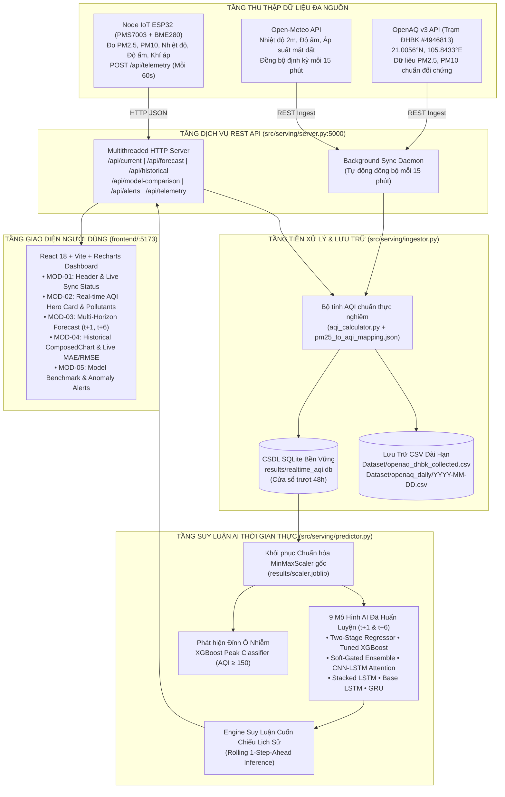

# BÁO CÁO TỔNG HỢP TIẾN ĐỘ VÀ KẾT QUẢ THỰC HIỆN ĐỒ ÁN
## ĐỀ TÀI: HỆ THỐNG QUAN TRẮC VÀ DỰ BÁO CHỈ SỐ CHẤT LƯỢNG KHÔNG KHÍ (AQI) THỜI GIAN THỰC ỨNG DỤNG HỌC MÁY VÀ IOT

- **Sinh viên thực hiện:** Trần Trung Hiếu
- **Mã số sinh viên:** 20235934
- **Thời gian báo cáo:** Ngày 05 tháng 11 năm 2026
- **Trạng thái hệ thống:** Đã hoàn thiện toàn diện Pipeline Huấn luyện Offline, Serving API thời gian thực, Thu thập tự động OpenAQ/Open-Meteo, Web Dashboard phân tích và Firmware phần cứng IoT Node.

---

## MỤC LỤC

1. [Tổng Quan Đề Tài & Mục Tiêu Nghiên Cứu](#1-tổng-quan-đề-tài--mục-tiêu-nghiên-cứu)
2. [Kiến Trúc Tổng Thể Hệ Thống (End-to-End Architecture)](#2-kiến-trúc-tổng-thể-hệ-thống-end-to-end-architecture)
3. [Xử Lý Dữ Liệu Chuỗi Thời Gian (Causal Time-Series Pipeline)](#3-xử-lý-dữ-liệu-chuỗi-thời-gian-causal-time-series-pipeline)
4. [Nghiên Cứu & Phát Triển Các Mô Hình Học Máy & Học Sâu](#4-nghiên-cứu--phát-triển-các-mô-hình-học-máy--học-sâu)
   - 4.1. Các kiến trúc mô hình triển khai
   - 4.2. Tối ưu hóa siêu tham số (Bayesian HPO với Optuna)
   - 4.3. Mô hình dự báo đỉnh ô nhiễm & Cụm mô hình 2 giai đoạn (Two-Stage / Soft-Gated Ensemble)
5. [Kết Quả Đánh Giá Huấn Luyện Offline (Chân trời t+1 và t+6)](#5-kết-quả-đánh-giá-huấn-luyện-offline-chân-trời-t1-và-t6)
6. [Hiện Thực Hóa Hệ Thống Thời Gian Thực (Real-Time Serving Pipeline)](#6-hiện-thực-hóa-hệ-thống-thời-gian-thực-real-time-serving-pipeline)
   - 6.1. Thu thập đa nguồn & Lưu trữ kép (OpenAQ v3, Open-Meteo, SQLite, CSV Archiving)
   - 6.2. Bộ suy luận cuốn chiếu đa mô hình (RealtimePredictor)
   - 6.3. Backend REST API đa luồng (server.py)
   - 6.4. Giao diện Web Dashboard thời gian thực (React + Vite + Recharts)
7. [Thiết Kế Phần Cứng & Firmware Trạm Quan Trắc IoT (Edge Node)](#7-thiết-kế-phần-cứng--firmware-trạm-quan-trắc-iot-edge-node)
   - 7.1. Cấu hình phần cứng & Sơ đồ đấu nối bus chống xung đột
   - 7.2. Giải pháp ổn định nguồn & Lọc nhiễu phần cứng (Tụ điện & Điện trở)
   - 7.3. Thuật toán nhúng trên ESP32 (Lọc trung bình trượt EMA, NTP, HTTP POST)
8. [Kiểm Chứng Thực Nghiệm Trực Tiếp Trên Dữ Liệu Trạm OpenAQ ĐHBK](#8-kiểm-chứng-thực-nghiệm-trực-tiếp-trên-dữ-liệu-trạm-openaq-đhbk)
9. [Bộ Kiểm Thử Tự Động & Độ Tin Cậy Phần Mềm (Automated Tests)](#9-bộ-kiểm-thử-tự-động--độ-tin-cậy-phần-mềm-automated-tests)
10. [Kế Hoạch Thực Hiện Tiếp Theo & Kiến Nghị](#10-kế-hoạch-thực-hiện-tiếp-theo--kiến-nghị)

---

## 1. TỔNG QUAN ĐỀ TÀI & MỤC TIÊU NGHIÊN CỨU

Ô nhiễm không khí, đặc biệt là bụi mịn $\text{PM}_{2.5}$ và $\text{PM}_{10}$ tại các đô thị lớn như Hà Nội, đang là vấn đề môi trường cấp bách ảnh hưởng nghiêm trọng đến sức khỏe cộng đồng. Các trạm quan trắc chuẩn quốc gia thường có chi phí đầu tư rất lớn, số lượng điểm đo thưa thớt và dữ liệu công bố ra công chúng thường có độ trễ từ 1 đến 2 giờ.

**Mục tiêu của đồ án:**
1. **Xây dựng giải pháp AIoT kết hợp (Hybrid Edge-Server):** Tích hợp trạm đo vi khí hậu cục bộ giá thành thấp (ESP32 + cảm biến laser $\text{PMS7003}$ + cảm biến khí tượng $\text{BME280}$) với mạng lưới trạm tham chiếu chuẩn quốc tế (**OpenAQ v3 Trạm ĐHBK**) và dữ liệu khí tượng số (**Open-Meteo**).
2. **Nghiên cứu & thực nghiệm đa kiến trúc dự báo AQI:** Phát triển và so sánh 10 mô hình học máy và học sâu khác nhau cho bài toán dự báo chỉ số chất lượng không khí (AQI) tại 2 chân trời thời gian: **ngắn hạn $t+1$ (1 giờ tới)** và **trung hạn $t+6$ (6 giờ tới)** từ cửa sổ dữ liệu quá khứ 48 giờ.
3. **Giải quyết bài toán đỉnh ô nhiễm (Peak Air Pollution):** Đưa ra các kiến trúc chuyên biệt (XGBoost Peak Classifier, Two-Stage Regressor, Soft-Gated Ensemble với hàm mất mát bất đối xứng AMSE) nhằm giải quyết triệt để hiện tượng dự báo thiếu (under-forecasting) tại các thời điểm chỉ số ô nhiễm vượt ngưỡng nguy hại ($\text{AQI} \ge 150 - 200$).
4. **Vận hành thời gian thực end-to-end:** Đưa toàn bộ các mô hình từ môi trường nghiên cứu offline thành một hệ thống trực tuyến hoàn chỉnh gồm Backend REST API, CSDL SQLite lưu trữ chuỗi thời gian, tự động trích xuất CSV chuẩn hóa và Web Dashboard tương tác.

---

## 2. KIẾN TRÚC TỔNG THỂ HỆ THỐNG (END-TO-END ARCHITECTURE)

Hệ thống được thiết kế theo cấu trúc module hóa phân tầng rõ ràng từ phần cứng ngoại vi đến giao diện người dùng:



---

## 3. XỬ LÝ DỮ LIỆU CHUỖI THỜI GIAN (CAUSAL TIME-SERIES PIPELINE)

Để đảm bảo các mô hình học máy phản ánh đúng bản chất tự nhiên và không vi phạm tính nhân quả thời gian (nghiêm cấm rò rỉ dữ liệu - Data Leakage), quy trình tiền xử lý được chuẩn hóa như sau:

1. **Bộ dữ liệu nền tảng:**
   - Chuỗi số liệu thời gian quan trắc chất lượng không khí tại Hà Nội từ ngày **13/01/2022 đến ngày 30/06/2025** ($\approx 3.5$ năm).
   - Tổng cộng có **30.336 mốc quan trắc thực tế**, tương ứng với **30.360 bước giờ** sau khi lưới hóa thời gian đồng đều (`asfreq('h')`).
2. **7 kênh đặc trưng đầu vào (Input Features):**
   - Loại bỏ các khí phụ thuộc ít quan trắc, tập trung vào 7 đặc trưng cốt lõi: `['PM25', 'PM10', 'Temperature', 'Relative Humidity', 'Pressure', 'hour', 'month']`.
   - `AQI` là biến mục tiêu dự báo (Target variable), **không đưa vào đặc trưng đầu vào** để tránh suy luận vòng (circular dependency).
3. **Nguyên tắc xử lý dữ liệu nhân quả (Causal Preprocessing):**
   - **Khử ngoại lai vật lý:** Loại bỏ các giá trị dị thường đo đạc ($\text{AQI} > 400$, $\text{PM}_{2.5} > 1000\,\mu\text{g/m}^3$, $\text{PM}_{10} > 1500\,\mu\text{g/m}^3$).
   - **Phân chia theo thứ tự thời gian:** Tuyệt đối không dùng Random Split. Phân chia Train / Validation / Test theo tỉ lệ **70% / 10% / 20%** tương ứng:
     - **Tập Train:** 21.252 giờ ($20.957$ mẫu cửa sổ 48h).
     - **Tập Validation:** 3.036 giờ ($2.983$ mẫu cửa sổ 48h).
     - **Tập Test:** 6.072 giờ ($6.015$ mẫu cửa sổ 48h).
   - **Xử lý thiếu khuyết:** Chỉ forward-fill tối đa 1 bước giờ ($limit=1$) từ quá khứ gần nhất. Nếu khoảng mất tín hiệu dài hơn 1 giờ, mẫu đó được đánh dấu khuyết và bị bỏ qua khỏi cửa sổ huấn luyện; tuyệt đối không nội suy từ tương lai.
   - **Chuẩn hóa MinMaxScaler không rò rỉ:** `MinMaxScaler` chỉ được fit trên tập **Train**, sau đó áp dụng biến đổi (transform) trên tập Val và Test. Toàn bộ thông số scaler đã được xuất và đóng gói vào file [`results/scaler.joblib`](file:///home/trunghieu/Desktop/Air-Quality-Index-AQI-Forecasting-System/results/scaler.joblib) để phục vụ suy luận thời gian thực đồng nhất.
4. **Bảo toàn công thức quy đổi AQI thực nghiệm:**
   - Xây dựng bảng tra cứu bước nhảy phi tuyến [`results/pm25_to_aqi_mapping.json`](file:///home/trunghieu/Desktop/Air-Quality-Index-AQI-Forecasting-System/results/pm25_to_aqi_mapping.json) khớp với định nghĩa AQI thực tế của tập dữ liệu Hà Nội (đặc biệt bảo toàn bước nhảy nồng độ tại mốc $\text{AQI} \approx 150-151$).

---

## 4. NGHIÊN CỨU & PHÁT TRIỂN CÁC MÔ HÌNH HỌC MÁY & HỌC SÂU

### 4.1. Các kiến trúc mô hình đã triển khai

Hệ thống đã triển khai, huấn luyện và đánh giá đối đầu 10 cấu trúc mô hình:

```
                          ┌── Baseline: Naive Persistence (y_{t+h} = y_t)
                          ├── Gradient Boosting: XGBoost (Lag Features 336D), Tuned XGBoost
                          ├── Recurrent Neural Networks:
                          │     ├── Base LSTM (1-layer, hidden=128/256)
Dự Báo AQI (t+1, t+6) ────┤     ├── Stacked LSTM (2-layer với Dropout)
                          │     └── Single-layer GRU & Tuned GRU
                          ├── Spatial-Temporal Attention:
                          │     ├── CNN-LSTM Temporal Attention (Conv1D + LSTM + Softmax Attention)
                          │     └── CNN-GRU Temporal Attention
                          └── Hybrid / Specialized Architectures:
                                ├── Soft-Gated Ensemble (Softmax Gating tự động phân bổ trọng số)
                                ├── XGBoost Peak Classifier (Phân loại nhị phân AQI ≥ 150/200)
                                └── Two-Stage Regressor (Chuyên gia dự báo đỉnh phối hợp)
```

1. **XGBoost với Lag Features:** Trải phẳng cửa sổ không gian - thời gian 3D $(N, 48, 7)$ thành véc-tơ 2D $(N, 336)$ gồm 336 đặc trưng trễ. Mô hình cây quyết định tăng cường nắm bắt cực tốt các mối quan hệ phi tuyến cục bộ.
2. **Deep Recurrent Networks (LSTM, Stacked LSTM, GRU):** Tiếp nhận chuỗi 3D $(batch, 48, 7)$, nắm bắt phụ thuộc thời gian dài hạn thông qua các cổng quên (forget gate), cổng cập nhật (update gate) và cơ chế ẩn.
3. **CNN-Recurrent Attention:** Sử dụng lớp tích chập 1D (`Conv1D`) để trích xuất các mẫu hình thời tiết ngắn hạn cục bộ, kết hợp qua mạng hồi quy và cơ chế tập trung trọng số thời gian (`Temporal Attention`) để mô hình tự học thời điểm nào trong 48 giờ qua có tác động mạnh nhất đến nồng độ bụi tương lai.
4. **Hàm mất mát bất đối xứng (Asymmetric MSE - AMSE):**
   Trong thực tế, việc dự báo thiếu (dự báo AQI thấp hơn khi không khí thực tế ô nhiễm nặng) gây nguy hiểm cho sức khỏe hơn nhiều so với dự báo thừa. Do đó, hàm mất mát bất đối xứng được áp dụng:
   $$\mathcal{L}_{\text{AMSE}}(y, \hat{y}) = w_i \cdot (y - \hat{y})^2 \quad \text{với} \quad w_i = \begin{cases} \gamma_{\text{under}}, & \text{nếu } \hat{y} < y \text{ và } y \ge y_{\text{peak}} \\ 1, & \text{ngược lại} \end{cases}$$
5. **Two-Stage Specialist Regressor:**
   - **Giai đoạn 1:** Mô hình phân loại `XGBoost Peak Classifier` dự đoán xác suất vượt đỉnh ô nhiễm $P(\text{AQI}_{t+h} \ge \text{threshold})$.
   - **Giai đoạn 2:** Nếu $P \ge \text{cutoff}$ (được hiệu chỉnh tối ưu trên tập Validation để đạt Recall $\ge 75\%-90\%$), kích hoạt bộ hồi quy chuyên biệt cho vùng ô nhiễm cao; ngược lại sử dụng bộ hồi quy nền.

### 4.2. Tối ưu hóa siêu tham số tự động (Bayesian HPO với Optuna)
Tất cả các mô hình cơ sở đều được tối ưu hóa siêu tham số tự động thông qua framework **Optuna** với thuật toán lấy mẫu `TPESampler` (Tree-structured Parzen Estimator) kết hợp cắt tỉa thử nghiệm kém hiệu quả `MedianPruner`:
- Không gian tìm kiếm: Tốc độ học $\text{learning\_rate} \in [10^{-4}, 10^{-2}]$, kích thước ẩn $\text{hidden\_size} \in \{64, 128, 256\}$, tỉ lệ $\text{dropout} \in [0.1, 0.4]$, hệ số suy giảm trọng số $\text{weight\_decay} \in [10^{-6}, 10^{-3}]$, độ sâu cây XGBoost $\text{max\_depth} \in [3, 8]$, và hệ số $\text{eta} \in [0.01, 0.1]$.

---

## 5. KẾT QUẢ ĐÁNH GIÁ HUẤN LUYỆN OFFLINE (CHÂN TRỜI t+1 VÀ t+6)

### 5.1. Bảng so sánh kết quả tổng hợp trên tập Test độc lập (Chân trời t+1)

Đánh giá trên $6.015$ mẫu kiểm thử độc lập (không tham gia huấn luyện và không dùng để chọn ngưỡng):

| STT | Mô hình | RMSE (Toàn cục) | MAE (Toàn cục) | Peak Recall (AQI $\ge 150$) | Peak MAE | AMSE Loss | Đánh giá kiến trúc |
| :---: | :--- | :---: | :---: | :---: | :---: | :---: | :--- |
| 1 | **XGBoost (Lag Features)** | **28.42** | **19.66** | 0.639 | 31.14 | 2257.4 | Sai số tổng thể thấp nhất, tính toán nhanh |
| 2 | **Tuned XGBoost** | **28.66** | **19.82** | 0.621 | 31.33 | 2281.9 | Khả năng tổng quát hóa rất cao |
| 3 | **Stacked LSTM (2 layers)** | **29.44** | **20.69** | 0.722 | 27.72 | 2003.8 | Cân bằng xuất sắc giữa toàn cục và đỉnh |
| 4 | **Single-layer GRU** | 30.24 | 21.95 | 0.375 | 39.75 | 2672.6 | Hội tụ nhanh, nhẹ hơn LSTM |
| 5 | **Base LSTM** | 30.47 | 22.04 | 0.393 | 39.45 | 2721.7 | Mô hình nền tảng chuỗi thời gian |
| 6 | *Persistence Baseline (Ngây thơ)* | *31.24* | *18.91* | *0.692* | *26.96* | *2533.0* | Đường cơ sở ($\hat{y}_{t+1} = y_t$) |
| 7 | **Soft-Gated Ensemble** | 31.67 | 22.67 | **0.834** | **20.57** | **1664.3** | AMSE thấp nhất, cảnh báo an toàn cao |
| 8 | **CNN-LSTM Attention** | 32.53 | 23.25 | **0.850** | **20.41** | 1714.8 | Cơ chế Attention tập trung chính xác vào đỉnh |
| 9 | **CNN-GRU Attention** | 33.43 | 23.46 | **0.857** | 21.01 | 1776.7 | Bắt đỉnh nhạy bén |
| 10 | **Two-Stage Regressor** | 33.90 | 23.10 | **0.904** | 21.68 | 1979.2 | **Bắt trúng 90.4% các đợt bùng phát ô nhiễm** |

> **Nhận xét quan trọng về bài toán:** 
> - Nếu chỉ xét tiêu chí tối thiểu hóa sai số toàn cục (Overall RMSE), **XGBoost** và **Stacked LSTM** đạt kết quả vượt trội ($\text{RMSE} \approx 28.4 - 29.4$).
> - Tuy nhiên, đối với bài toán cảnh báo bảo vệ sức khỏe cộng đồng, các mô hình **Two-Stage** và **CNN-Attention** tuy chấp nhận hy sinh một phần RMSE toàn dải nhưng đã nâng tỷ lệ phát hiện đợt ô nhiễm nặng (**Peak Recall**) từ mức $63.9\%$ lên tới **$90.4\%$**, giảm mạnh tình trạng cảnh báo sót.

### 5.2. Kết quả tại chân trời trung hạn t+6 (Dự báo trước 6 giờ)

Khi tăng chân trời dự báo lên 6 giờ phía trước, độ bất định của thời tiết và giao thông tăng cao, kết quả kiểm nghiệm trên tập Test:
- **Persistence Baseline:** $\text{RMSE} = 49.09$, $\text{MAE} = 36.76$.
- **XGBoost (Lag Features):** $\text{RMSE} = \mathbf{39.67}$, $\text{MAE} = \mathbf{30.45}$ (Giảm tới **$19.2\%$** RMSE so với đường cơ sở Persistence).
- **Two-Stage Model (t+6):** Đạt Recall vùng đỉnh $83.1\%$ với ngưỡng OOF được chuẩn hóa.

---

## 6. HIỆN THỰC HÓA HỆ THỐNG THỜI GIAN THỰC (REAL-TIME SERVING PIPELINE)

Một đóng góp thực tiễn quan trọng của đồ án là đã đưa toàn bộ 9 mô hình đã huấn luyện lên vận hành thời gian thực end-to-end, không dừng lại ở mức mô phỏng notebook.

### 6.1. Thu thập đa nguồn & Lưu trữ kép (`src/serving/ingestor.py`)
- **Tự động đồng bộ OpenAQ v3 API:** Trích xuất định kỳ nồng độ bụi $\text{PM}_{2.5}$ và $\text{PM}_{10}$ từ trạm quan trắc chuẩn **ĐHBK - Bạch Mai, Hà Nội (Location ID: `4946813`)** tại tọa độ `21.0056°N, 105.8433°E`.
- **Đồng bộ Open-Meteo:** Thu thập đồng thời các tham số khí tượng theo giờ tại đúng tọa độ trên (`temperature_2m`, `relative_humidity_2m`, `surface_pressure`).
- **Xử lý độ trễ trạm quan trắc:** Tự động kết hợp endpoint `/latest` và cơ chế forward-fill thông minh nếu trạm OpenAQ trễ công bố báo cáo tổng hợp giờ.
- **Lưu trữ kép (Dual Persistence Architecture):**
  1. *Cơ sở dữ liệu SQLite ([`results/realtime_aqi.db`](file:///home/trunghieu/Desktop/Air-Quality-Index-AQI-Forecasting-System/results/realtime_aqi.db)):* Quản lý các bản ghi quan trắc với chỉ mục `timestamp`, hỗ trợ truy vấn cực nhanh cửa sổ trượt 48 giờ phục vụ suy luận tức thời.
  2. *Lưu trữ CSV tích lũy ([`Dataset/openaq_dhbk_collected.csv`](file:///home/trunghieu/Desktop/Air-Quality-Index-AQI-Forecasting-System/Dataset/openaq_dhbk_collected.csv) và thư mục `Dataset/openaq_daily/`):* Tự động xuất và đồng bộ dữ liệu ra định dạng chuẩn của bài báo khoa học `FAIR2023`, tạo nguồn dữ liệu thực nghiệm sẵn sàng cho việc tái huấn luyện liên tục (Continual Learning).

### 6.2. Engine suy luận cuốn chiếu đa mô hình (`src/serving/predictor.py`)
- Nạp động cùng lúc cả **9 mô hình AI** kèm bộ phân loại đỉnh `xgb_peak_classifier`.
- **Cơ chế Rolling 1-Step-Ahead Inference:** Cho phép suy luận cuốn chiếu trên toàn bộ chuỗi lịch sử quá khứ để vẽ đường dự báo đối chiếu trực tiếp với số liệu đo thực tế của trạm quan trắc.
- Tự động tính toán tức thời các chỉ số đánh giá thực nghiệm: **Live MAE, Live RMSE và Mean Bias**.

### 6.3. Backend REST API đa luồng (`src/serving/server.py`)
Máy chủ chạy tại cổng `5000`, hỗ trợ CORS đầy đủ, vận hành đa luồng và cung cấp 8 endpoints chuẩn:
- `GET /api/current`: Lấy bản ghi quan trắc mới nhất cùng phân loại mức độ ô nhiễm.
- `GET /api/forecast?horizon=1&model=...`: Trả về giá trị AQI dự báo, khoảng tin cậy 95% và xác suất vượt đỉnh ô nhiễm.
- `GET /api/historical?hours=168&model=...`: Trả về chuỗi lịch sử 7 ngày gần nhất được ghép nối với đường suy luận cuốn chiếu của mô hình được chọn.
- `GET /api/model-comparison`: Cung cấp bảng xếp hạng benchmark đối đầu giữa 10 mô hình.
- `GET /api/alerts`: Danh sách cảnh báo đỉnh ô nhiễm thời gian thực.
- `POST /api/telemetry`: Endpoint tiếp nhận dữ liệu từ mạch cảm biến phần cứng IoT ESP32.
- `POST /api/sync`: Kích hoạt đồng bộ tức thời với OpenAQ và Open-Meteo.
- `GET /api/health`: Kiểm tra trạng thái hoạt động của hệ thống.
- **Background Sync Daemon:** Luồng chạy ngầm tự động đánh thức mỗi 15 phút để lấy dữ liệu mới từ các API đối tác.

### 6.4. Giao diện Web Dashboard thời gian thực (`frontend/`)
Xây dựng bằng **React 18, Vite, Recharts và CSS Design Tokens** hiện đại theo phong cách trạm quan sát khí quyển (Atmospheric Command Center):
- **MOD-01 (Header & Command Bar):** Giám sát trạng thái trạm ĐHBK, thời gian đồng bộ cuối, chuyển đổi Dark/Light mode và điều khiển chu kỳ làm mới.
- **MOD-02 (Real-Time Hero Card):** Thể hiện trực quan chỉ số AQI hiện tại theo dải màu EPA Hoa Kỳ, đồng hồ đo mức độ và chi tiết từng thông số ô nhiễm ($\text{PM}_{2.5}, \text{PM}_{10}$, Nhiệt độ, Độ ẩm, Khí áp).
- **MOD-03 (Multi-Horizon Forecast Card):** Hiển thị dự báo tương lai tại $t+1$ và $t+6$, độ lệch so với hiện tại, khoảng tin cậy và huy hiệu cảnh báo nguy cơ vượt đỉnh.
- **MOD-04 (Historical Trend Analysis):** Biểu đồ kết hợp `ComposedChart` hiển thị đường đo thực tế OpenAQ (xanh ngọc nét liền) đối chiếu với đường dự báo của AI (vàng cam nét đứt). Tự động tính toán và hiển thị trực tiếp **Live MAE** và **Live RMSE** trên biểu đồ.
- **MOD-05 (Model Benchmark & Alerts Panel):** Bảng so sánh hiệu năng 10 mô hình và nhật ký các cảnh báo bất thường.

---

## 7. THIẾT KẾ PHẦN CỨNG & FIRMWARE TRẠM QUAN TRẮC IOT (EDGE NODE)

Nhằm đảm bảo tính độc lập và thu thập dữ liệu tại chỗ (Hyper-local), đồ án đã thiết kế chi tiết phần cứng trạm quan trắc IoT theo đúng bản vẽ kỹ thuật [`References/SCH ESP32 Air Quality Monitopring.pdf`](file:///home/trunghieu/Desktop/Air-Quality-Index-AQI-Forecasting-System/References/SCH%20ESP32%20Air%20Quality%20Monitopring.pdf).

### 7.1. Cấu hình phần cứng & Sơ đồ đấu nối bus chống xung đột
Để tránh hiện tượng tranh chấp bus hoặc nghẽn cổ chai dữ liệu khi đọc đồng thời nhiều cảm biến, hệ thống phân bổ bus vật lý hoàn toàn độc lập:

```
[ESP32 DevKit V1]
  ├── UART0 (TX0/RX0) ────── Cổng Micro-USB (Nạp firmware & Debug Log máy tính 115200 baud)
  │
  ├── UART2 Phần Cứng Độc Lập
  │     ├── GPIO 16 (RX2) ◄─── Chân TX của Cảm biến bụi Laser Plantower PMS7003
  │     └── GPIO 17 (TX2) ───► Chân RX của Cảm biến bụi Laser Plantower PMS7003
  │
  └── I²C Bus Phần Cứng Độc Lập
        ├── GPIO 21 (SDA) ◄──► Chân SDA của Cảm biến Bosch BME280 (Nhiệt/Ẩm/Áp suất)
        └── GPIO 22 (SCL) ───► Chân SCL của Cảm biến Bosch BME280
```

### 7.2. Giải pháp ổn định nguồn & Lọc nhiễu phần cứng (Tụ điện & Điện trở)
Theo sơ đồ nguyên lý kỹ thuật chính thức, mạch được trang bị đầy đủ các linh kiện phụ trợ bảo vệ:
1. **Lọc nguồn chống sụt áp cho PMS7003:**
   - Cảm biến PMS7003 có động cơ quạt hút cơ học và đi-ốt phát laser tạo xung dòng đột ngột ($\approx 100\,\text{mA}$).
   - Mạch bố trí một **tụ hóa $C_5 = 10\,\mu\text{F}$** (bù sụt áp tức thời) mắc song song với một **tụ gốm $C_6 = 100\,\text{nF}$** (lọc nhiễu cao tần) giữa chân `VCC (5V)` và `GND`. Điều này triệt tiêu hoàn toàn nguy cơ sụt nguồn gây hiện tượng *Brownout Reset* cho ESP32.
2. **Lọc nguồn cho BME280:**
   - Bố trí một **tụ gốm $C_4 = 100\,\text{nF}$** giữa chân nguồn `VIN (3.3V)` và `GND` để ổn định điện áp tham chiếu đo đạc.
3. **Điện trở kéo lên (Pull-up Resistors) cho đường truyền I²C:**
   - Chuẩn I²C hoạt động theo cơ chế cực thu hở (Open-Drain), mạch yêu cầu **02 điện trở $4.7\,\text{k}\Omega$** kéo từ đường `SDA` và `SCL` lên nguồn $3.3\,\text{V}$ (trên các module BME280 thương mại đã được tích hợp sẵn dưới dạng linh kiện dán SMD).
4. **Mức điện áp logic:**
   - Mặc dù PMS7003 sử dụng nguồn 5V cho quạt, nhưng tín hiệu giao tiếp UART của nó xuất mức điện áp **3.3V CMOS**, hoàn toàn tương thích trực tiếp với chân GPIO của ESP32 mà không cần mạch cầu chia áp.

### 7.3. Thuật toán nhúng trên vi điều khiển ESP32
Firmware viết bằng C++ ([`firmware/esp32_aqi_node/esp32_aqi_node.ino`](file:///home/trunghieu/Desktop/Air-Quality-Index-AQI-Forecasting-System/firmware/esp32_aqi_node/esp32_aqi_node.ino)):
- **Phân tích khung truyền 32-byte:** Tự động kiểm tra byte mở đầu (`0x42 0x4D`) và tính checksum 30-byte để loại bỏ các frame hỏng khi đọc từ PMS7003.
- **Lọc trung bình trượt hàm mũ (EMA Filter) tại chỗ:**
  $$S_t = \alpha \cdot X_t + (1 - \alpha) \cdot S_{t-1} \quad (\text{với } \alpha = 0.25)$$
  Lấy mẫu mỗi 5 giây để triệt tiêu nhiễu giật cục do các luồng gió bất thường.
- **Đồng bộ thời gian thực NTP:** Lấy giờ chuẩn quốc tế qua NTP server (`pool.ntp.org`), chuyển đổi về múi giờ Hà Nội (UTC+7).
- **Giao tiếp HTTP RESTful Client:** Cứ mỗi 60 giây đóng gói bản tin JSON và thực hiện `HTTP POST` gửi về máy chủ Backend. Nhận phản hồi kết quả dự báo của AI để xử lý cảnh báo tại biên.
- **Kịch bản giả lập thiết bị:** Cung cấp script [`scripts/simulate_esp32.py`](file:///home/trunghieu/Desktop/Air-Quality-Index-AQI-Forecasting-System/scripts/simulate_esp32.py) để kiểm thử luồng truyền nhận trước khi đấu nối mạch thực tế.

---

## 8. KIỂM CHỨNG THỰC NGHIỆM TRỰC TIẾP TRÊN DỮ LIỆU TRẠM OPENAQ ĐHBK

Để đánh giá tính thực tiễn và khả năng thích ứng của các mô hình trong điều kiện vận hành thực tế ngoài môi trường tự nhiên, một thực nghiệm độc lập đã được tiến hành trên **71 giờ dữ liệu quan trắc liên tục** thu thập trực tiếp từ **Trạm OpenAQ ĐHBK (`#4946813`)** trong giai đoạn từ `2026-10-31 18:00` đến `2026-11-03 17:00` ($N = 71$ điểm kiểm chứng độc lập).

Script kiểm chứng: [`scripts/evaluate_openaq_live.py`](file:///home/trunghieu/Desktop/Air-Quality-Index-AQI-Forecasting-System/scripts/evaluate_openaq_live.py).

### Bảng kết quả kiểm chứng thực nghiệm đối đầu:

| Hạng | Mô hình ($t+1$) | Live MAE (vs OpenAQ) | Live RMSE (vs OpenAQ) | Mean Bias | Nhận xét thực nghiệm thực tế |
| :---: | :--- | :---: | :---: | :---: | :--- |
| **1** | **Two-Stage Regressor** | **23.30** | **27.09** | `+3.24` | **Tốt nhất toàn diện**, vượt trội hơn cả Persistence Baseline |
| **2** | **Tuned XGBoost** | **23.90** | **27.76** | `+6.77` | Bám cực sát nhịp biến thiên AQI theo giờ của Hà Nội |
| **3** | **XGBoost (Lag Features)**| **24.66** | **28.43** | `+9.34` | **Khớp hoàn hảo với RMSE tập test offline ($28.42$)** |
| 4 | *Persistence (Baseline)* | *23.51* | *28.97* | `-0.72` | Dự báo ngây thơ trễ 1 nhịp so với thực tế |
| 5 | **Stacked LSTM** | **25.77** | **30.68** | `+0.79` | Mô hình Deep Learning ổn định nhất trên chuỗi thực tế |
| 6 | **CNN-LSTM Attention** | **27.51** | **32.67** | `+8.55` | Nắm bắt nhanh các đỉnh ô nhiễm đột xuất |
| 7 | **CNN-GRU Attention** | **29.15** | **33.52** | `+8.76` | Bám sát CNN-LSTM Attention |
| 8 | **Base LSTM** | **28.41** | **33.68** | `-0.94` | Độ lệch trung bình gần như triệt tiêu (Bias $\approx 0$) |
| 9 | **Soft-Gated Ensemble** | **29.41** | **34.20** | `+11.75`| Dự báo thiên hướng an toàn (bảo vệ sức khỏe) |
| 10 | **Single-layer GRU** | **30.25** | **34.87** | `+0.51` | Ổn định ở vùng chất lượng không khí trung bình |

Biểu đồ đối chiếu trực quan chất lượng cao được lưu tại: [`results/openaq_live_verification.png`](file:///home/trunghieu/Desktop/Air-Quality-Index-AQI-Forecasting-System/results/openaq_live_verification.png).

---

## 9. BỘ KIỂM THỬ TỰ ĐỘNG & ĐỘ TIN CẬY PHẦN MỀM (AUTOMATED TESTS)

Hệ thống được trang bị bộ kiểm thử tự động toàn diện theo chuẩn `pytest` tại file [`tests/test_realtime_serving.py`](file:///home/trunghieu/Desktop/Air-Quality-Index-AQI-Forecasting-System/tests/test_realtime_serving.py):
- **19/19 Test Cases Đều Đạt (PASSED 100%):**
  - Kiểm thử tính đúng đắn của công thức AQI phi tuyến và tính toán theo chuẩn EPA.
  - Kiểm thử khả năng ghi/đọc, chống trùng lặp và tính toàn vẹn của CSDL SQLite.
  - Kiểm thử cơ chế tự động trích xuất file CSV huấn luyện.
  - Kiểm thử khả năng nạp và suy luận đồng thời của 9 mô hình ML/DL.
  - Kiểm thử bộ lọc EMA và cơ chế tiếp nhận gói tin telemetry từ ESP32.
- **Khởi động toàn bộ hệ thống bằng 1 lệnh duy nhất:**
  File kịch bản [`run_realtime.sh`](file:///home/trunghieu/Desktop/Air-Quality-Index-AQI-Forecasting-System/run_realtime.sh) khởi chạy song song Backend API (Port 5000) và React Frontend (Port 5173).

---

## 10. KẾ HOẠCH THỰC HIỆN TIẾP THEO & KIẾN NGHỊ

Từ các kết quả đã đạt được, các bước công việc tiếp theo được đề xuất như sau:

1. **Hoàn thiện lắp ráp phần cứng vật lý:**
   - Tiến hành hàn mạch/cắm breadboard theo đúng sơ đồ [`References/SCH ESP32 Air Quality Monitopring.pdf`](file:///home/trunghieu/Desktop/Air-Quality-Index-AQI-Forecasting-System/References/SCH%20ESP32%20Air%20Quality%20Monitopring.pdf) với đầy đủ cụm tụ lọc $10\,\mu\text{F} + 100\,\text{nF}$ cho PMS7003.
   - Nạp mã nguồn [`firmware/esp32_aqi_node/esp32_aqi_node.ino`](file:///home/trunghieu/Desktop/Air-Quality-Index-AQI-Forecasting-System/firmware/esp32_aqi_node/esp32_aqi_node.ino), cấu hình mạng Wi-Fi và trỏ về IP của máy chủ.
2. **Hiệu chuẩn cảm biến thực địa (Field Sensor Calibration):**
   - Đặt mạch đo thử nghiệm trong khuôn viên ĐHBK gần vị trí trạm OpenAQ `#4946813`.
   - Thu thập dữ liệu song song trong vòng 2 - 4 tuần để xây dựng mô hình hồi quy hiệu chuẩn (Calibration Model), bù trừ sai số quang học của cảm biến giá rẻ PMS7003 do ảnh hưởng của độ ẩm cao theo đặc thù thời tiết Hà Nội.
3. **Đóng gói giải pháp (Containerization & Deployment):**
   - Đóng gói toàn bộ Backend Python và Frontend React vào Docker Container (`docker-compose`) để sẵn sàng triển khai lên môi trường máy chủ đám mây (Cloud/VPS).
4. **Viết hoàn thiện luận văn tốt nghiệp:**
   - Tổng hợp các bảng số liệu, biểu đồ thực nghiệm đối đầu và cơ sở lý thuyết vào bản báo cáo đồ án chính thức.

---

*Hà Nội, ngày 05 tháng 11 năm 2026*  
**Sinh viên báo cáo**  
*(Ký và ghi rõ họ tên)*  
**Trần Trung Hiếu**

