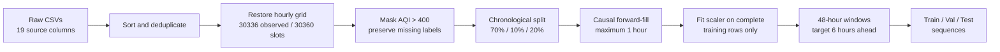

# Air-Quality-Index-AQI-Forecasting-System

A backend pipeline for forecasting the Air Quality Index (AQI) in Hanoi 6 hours ahead (t+6), using multiple model architectures — **LSTM**, **Stacked LSTM**, **GRU**, and **XGBoost (with Lag Features)** — built on PyTorch.

The pipeline takes a 48-hour historical sliding window of environmental and air-quality IoT sensor data as input, and outputs the forecasted AQI value for the next 6 hours.

---

## Table of Contents

- [Key Features](#key-features)
- [System Requirements & Tool Versions](#system-requirements--tool-versions)
- [Installation](#installation)
- [How to Run](#how-to-run)
- [Repository Structure](#repository-structure)
- [Module Descriptions](#module-descriptions)
- [Data Pipeline](#data-pipeline)
- [Results](#results)
- [Future Work](#future-work)

---

## Key Features

- Time-series data processing that preserves temporal continuity, without dropping records
- Training and comparison of multiple model architectures: Base LSTM, Stacked LSTM, GRU, XGBoost
- Automatic hyperparameter optimization with Optuna (Bayesian HPO, TPESampler + MedianPruner)
- Objective evaluation against a Naive Persistence Baseline
- Modular architecture, separated into config / data / model / train / evaluate / visualize / utils
- Logging and reproducibility via fixed random seeds

---

## System Requirements & Tool Versions

| Tool | Version |
|------|---------|
| Python | 3.10+ |
| PyTorch | >= 2.0 |
| scikit-learn | >= 1.0 |
| Optuna | >= 3.0 |
| Pandas | >= 1.5 |
| NumPy | >= 1.23 |
| Matplotlib | >= 3.6 |
| XGBoost | >= 3.0 |

---

## Installation

```bash
# 1. Clone the repository
git clone <repository-url>
cd Air-Quality-Index-AQI-Forecasting-System

# 2. Create a virtual environment
python -m venv .venv

# 3. Activate the virtual environment
# Windows:
.venv\Scripts\activate
# Linux/macOS:
source .venv/bin/activate

# 4. Install dependencies
pip install -r requirements.txt
```

### Dependencies (requirements.txt)

```text
pandas
numpy
torch
scikit-learn
matplotlib
optuna
seaborn
jupyter
xgboost
```

---

## How to Run

program/` directory:

```bash
# Train Base LSTM model
python "main program/main.py"

# Train Stacked LSTM model
python "main program/stacked_main.py"

# Train and evaluate Single-layer GRU
python "main program/run_gru.py"

# Train and evaluate XGBoost (Lag Features, default params)
python "main program/run_xgb.py"

# Train an AQI >= 200 peak classifier and compare recall/alert-rate trade-offs
python "main program/run_xgb_peak_classifier.py"

# Compare AMSE baselines and train a soft-gated XGBoost/GRU/Stacked-LSTM ensemble
python "main program/run_hybrid_ensemble.py"

# Compare CNN-GRU and CNN-LSTM with temporal attention, trained with AMSE
python "main program/run_cnn_recurrent_attention.py"

# Walk-forward validation and two-stage peak classifier/regressor
python "main program/run_walk_forward_two_stage.py"

# Compare XGBoost, recurrent, soft-gated, and two-stage models with expanding-window CV
python "main program/run_expanding_window_cv.py"

# HPO + retrain: Tuned Base LSTM
python "main program/tune_main.py"

# HPO + retrain: Tuned Stacked LSTM
python "main program/tune_stacked_main.py"

# HPO + retrain: Tuned GRU
python "main program/tune_gru_main.py"

# HPO + retrain: Tuned XGBoost
python "main program/tune_xgb_main.py"

# Generate overlay comparison charts
python compare_tuned_models.py
python compare_tuned_vs_untuned.py
```

Logs, loss-curve plots, and prediction charts are saved to the `results/` folder.

---

## Repository Structure

```text
Air-Quality-Index-AQI-Forecasting-System/
├── src/                          # Core package
│   ├── config.py                 # Global hyperparameters, feature columns, split ratios, device, seed
│   ├── data_loader.py            # Data pipeline (+ get_xgboost_data)
│   ├── model.py                  # LSTMAQIModel, StackedLSTMAQIModel, GRUAQIModel
│   ├── train.py                  # Training loop with early stopping
│   ├── hybrid_ensemble.py        # AQI-weighted AMSE and soft gating
│   ├── time_series_cv.py         # Fold-local expanding-window data preparation
│   ├── tune.py                   # Optuna objective functions
│   ├── evaluate.py               # Metrics + persistence baseline
│   ├── visualize.py              # Plotting utilities
│   └── utils.py                  # DualLogger context manager
├── main program/                 # Entry points for training / tuning
│   ├── main.py                   # Entry point: Base LSTM
│   ├── stacked_main.py           # Entry point: Stacked LSTM
│   ├── run_gru.py                # Entry point: Single-layer GRU
│   ├── run_xgb.py                # Entry point: XGBoost (Lag Features)
│   ├── run_xgb_peak_classifier.py # Entry point: XGBoost AQI peak classifier
│   ├── run_hybrid_ensemble.py    # AMSE baselines + soft-gated hybrid ensemble
│   ├── run_cnn_recurrent_attention.py # Compare CNN-GRU/LSTM with temporal attention
│   ├── run_walk_forward_two_stage.py # Walk-forward peak classifier + specialist regression
│   ├── run_expanding_window_cv.py # Cross-validated comparison of principal forecasters
│   ├── tune_main.py              # Entry point: HPO + train Tuned Base LSTM
│   ├── tune_stacked_main.py      # Entry point: HPO + train Tuned Stacked LSTM
│   ├── tune_xgb_main.py          # Entry point: HPO + train Tuned XGBoost
│   └── tune_gru_main.py          # Entry point: HPO + train Tuned GRU
├── Dataset/                      # Raw dataset
│   ├── archive/                  # CSV files (air quality data)
│   └── Copy of Air Quality ForeCasting.ipynb  # Original research notebook
├── results/                      # Run outputs
│   ├── base_results.txt          # Base LSTM run log
│   ├── stacked_results.txt       # Stacked LSTM run log
│   ├── tuned_results_*.txt       # Tuned model run logs
│   ├── gru_results.txt           # GRU run log
│   ├── xgb_results.txt           # XGBoost run log
│   ├── *_loss_curve.png          # Loss curve plots
│   └── *_test_predictions.png    # Prediction charts
├── requirements.txt              # Dependencies
└── README.md                     # Project description
```

---

## Module Descriptions

| Module | File | Function |
|--------|------|----------|
| **Configuration** | `src/config.py` | Defines all hyperparameters, feature columns, data split ratios, device, and random seed |
| **Data Processing** | `src/data_loader.py` | Reads CSV, restores the hourly timeline, masks AQI outliers, splits chronologically, forward-fills at most one missing hour, fits MinMaxScaler on complete training rows, and creates sliding-window sequences. Also supports `get_xgboost_data()` to return flattened arrays and optional target timestamps for XGBoost |
| **Models** | `src/model.py` | Defines base/stacked LSTM, GRU, and CNN-recurrent attention models (`CNNRecurrentAttentionAQIModel`) |
| **Training** | `src/train.py` | Training loop with early stopping, checkpointing, and trial pruning support for Optuna |
| **HPO Tuning** | `src/tune.py` | Objective functions for Optuna – samples lr, hidden_size, dropout, weight_decay; trains and returns best val loss |
| **Evaluation** | `src/evaluate.py` | Calculates RMSE, MAE on unscaled data; calculates Naive Persistence Baseline |
| **Visualization** | `src/visualize.py` | Plots loss curves and actual vs. predicted AQI charts |
| **Utilities** | `src/utils.py` | `DualLogger` – a context manager that logs output to both console and file simultaneously, ensuring exception safety |

### LSTM / GRU Model Architecture

```text
Input: (batch_size, 48, 13)    ← 48 timesteps × 13 features
         │
    ┌────▼────┐
    │  LSTM   │  hidden_size = 128 (base) / 256 (tuned)
    │  (or    │  num_layers = 1 (Base/GRU) or 2 (Stacked)
    │  GRU)   │  batch_first = True
    └────┬────┘
         │  h_n[-1] → (batch_size, hidden_size)
    ┌────▼────┐
    │ Dropout │  p = 0.2 (base) / tuned
    └────┬────┘
    ┌────▼────┐
    │ Linear  │  hidden_size → 1
    └────┬────┘
         │
Output: (batch_size, 1)        ← forecasted AQI at t+6
```

### XGBoost (Lag Features) Model Architecture

```text
Input 3D: (N, 48, 13)
         │  reshape / flatten
Input 2D: (N, 624)   ← 48 timesteps × 13 features = 624 lag features
         │
    ┌────▼────────────────┐
    │  XGBRegressor        │  booster = gbtree, max_depth = 5 (tuned)
    │  (Gradient Boosting) │  eta = 0.0349 (tuned)
    └────┬────────────────┘
         │
Output: (N,)   ← forecasted AQI at t+6
```

---

## Data Pipeline



Dataset used: Hanoi air-quality time series from 2022-01-13 00:00 through 2025-06-30 23:00. The CSVs contain 30,336 unique observed timestamps and 19 source columns; one 24-hour outage is restored as missing hourly slots during preprocessing. The model uses AQI, PM2.5, PM10, CO, NO₂, O₃, SO₂, temperature, humidity, wind speed, pressure, hour, and month.

Processing principles:
- Restore missing hourly timestamps without interpolating measurements
- Split chronologically before filling missing inputs; forward-fill at most one missing hourly sample from the prior observation
- Keep longer outages missing and skip any 48-hour input windows containing missing readings
- Do not impute missing AQI targets; exclude those forecast examples from training and evaluation
- Avoid data leakage (fit the scaler only on the training set)
- Split the data chronologically

The existing tuned-XGBoost results are retained as a **legacy baseline**:
the saved checkpoint and `results/tuned_xgb_results_20260717_075406.txt` are
unchanged. On the original holdout, the model scored RMSE 39.6817 and MAE
30.2843. At the report's high-peak cutoff (AQI >= 200), it detected 246 of
993 peak forecasts (recall 0.2477), with 232 false alerts and peak MAE
56.4342. This cutoff is for model evaluation only, not an official warning
threshold. Those legacy metrics used the previous interpolation pipeline;
models must be retrained with the causal pipeline before claiming comparable
performance.

`get_xgboost_data(..., include_target_timestamps=True)` provides target times
for holdout evaluation. XGBoost evaluation reports peak-period RMSE/MAE,
precision, recall, F1, missed peaks, false positives, and false forecast alerts
per week. Keep the chronological test split untouched when selecting models or
thresholds.

The separate `run_xgb_peak_classifier.py` trains a class-weighted XGBoost
classifier for whether the AQI six hours ahead will be at least 200. It selects
candidate probability cutoffs on validation to reach several recall targets,
then reports test recall, precision, F1, and false alerts per week at those
same cutoffs. This exposes the recall/alert trade-off without selecting a
threshold on the test set. Logs and the model are saved under `results/`.

`run_hybrid_ensemble.py` compares AMSE-trained XGBoost, GRU, and stacked LSTM
forecasts with standalone and equal-weight baselines. AMSE increases sample
weights above the configured AQI peak threshold and penalizes under-forecasting
more heavily. A softmax gate learns input-dependent blend weights from the
chronological validation split; final performance is measured on the untouched
test split. Logs, model checkpoints, and the fitted gate are saved under
`results/`.

`run_cnn_recurrent_attention.py` trains and compares both CNN-GRU and CNN-LSTM
models. A temporal convolution extracts short-range patterns from the input
window, the recurrent layer models sequential context, and learned attention
weights pool the time steps before AQI regression. Both use the same AMSE loss,
chronological split, early stopping, and test metrics as the hybrid experiment.
Use the validation results for model selection; test results are for final
comparison only.

`run_walk_forward_two_stage.py` evaluates a peak classifier, a general AQI
regressor, and a high-AQI specialist using four expanding-window folds over
the pre-test timeline. It calibrates the peak-probability cutoff from pooled
out-of-fold predictions to target 75% recall, refits on all pre-test data, and
reports final metrics once on the untouched test split. The report includes
overall and actual-peak-only errors, peak bias, recall, F1, precision, and
false alerts per week.

`run_expanding_window_cv.py` compares standard and AMSE XGBoost, AMSE GRU and
stacked LSTM, their soft-gated ensemble, and the two-stage peak regressor across
four expanding-window folds. Each fold fits its scaler on the training prefix,
uses the first half of the following block for early stopping and calibration,
and scores on the later half. The final test period is excluded from this
comparison. Results are saved to `results/expanding_window_cv_results.txt`.

Initial single-seed experiment:

| Test model | Overall RMSE | Overall MAE | Actual-peak RMSE | Actual-peak MAE | Peak bias | Recall | Precision | False alerts/week |
|---|---:|---:|---:|---:|---:|---:|---:|---:|
| Soft-gated ensemble | 42.620 | 33.758 | 46.558 | 36.565 | -27.856 | 0.581 | 0.435 | — |
| Two-stage (75% OOF recall cutoff) | 53.410 | 41.101 | 46.091 | 32.102 | -16.106 | 0.831 | 0.315 | 50.21 |

The two-stage model improved peak-value MAE and recall in this run, but its
lower precision and high false-alert rate came with substantially worse
overall RMSE/MAE. This operating point is not automatically preferable; choose
the cutoff based on an acceptable false-alert budget. The validation peak
prevalence also varied sharply across rolling folds (14, 498, 112, and 66
peaks per 2,950 samples), while the final test contained 996 peaks in 5,967
samples. Treat these single-seed results as exploratory, not as a robust
estimate under the observed prevalence shift.

---

## Results

### Test Set Performance vs. Baseline

| Model / Baseline | Test RMSE | Test MAE |
| :--- | :---: | :---: |
| Naive Baseline (Persistence) | 49.1951 | 36.8173 |
| Base LSTM | 41.2524 | 32.3012 |
| Stacked LSTM | 41.0533 | 31.7970 |
| Tuned Base LSTM | 40.9869 | 31.7906 |
| Tuned Stacked LSTM | 40.8716 | 31.5892 |
| Single-layer GRU | 40.6944 | 31.9603 |
| Tuned Single-layer GRU | 40.4583 | 31.3893 |
| XGBoost (Lag Features) | 39.8709 | 30.4246 |
| **Tuned XGBoost** | **39.6817** | **30.2843** |

All trained models clearly outperform the Naive Persistence Baseline. **Tuned XGBoost** achieves the best overall test performance, benefiting from Bayesian hyperparameter optimization that reduced its train/val overfitting gap from 5.42 to 2.68 RMSE points, which in turn translated into a real (if modest) generalization gain on the test set.

For the full breakdown of train/validation performance, hyperparameter analysis, loss curves, and actual-vs-predicted AQI charts, see the full project report.

---

## Future Work

- Integrate real-time IoT ingestion via REST API or MQTT instead of running offline on static CSV files
- Improve forecasting of high AQI spikes (>200) using Huber Loss, Quantile Loss, or oversampling
- Extend hyperparameter tuning coverage and trial budget for XGBoost
- Extend to multi-step forecasting (t+1 through t+24) instead of single-step t+6
- Explore Transformer/Attention architectures or an ensemble of LSTM and XGBoost

---

## License

Not yet specified.
